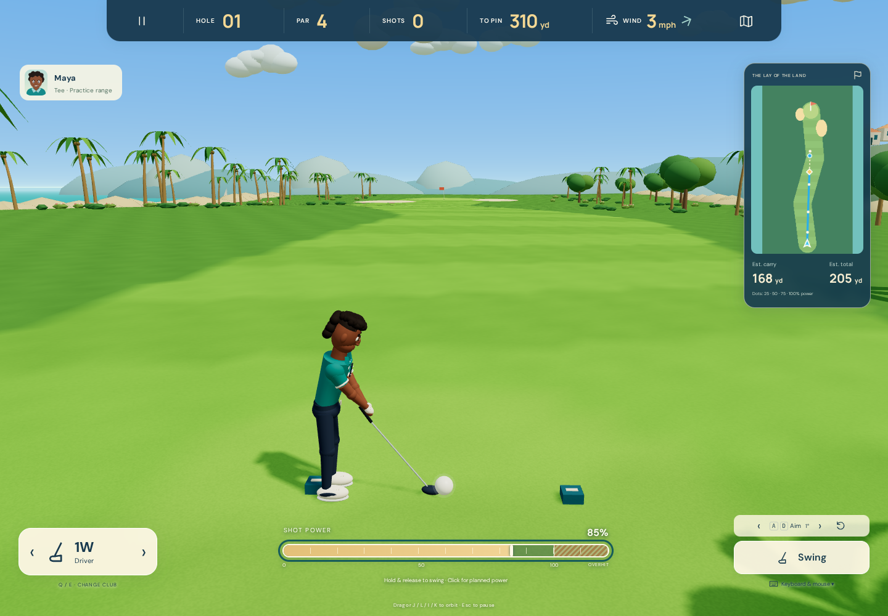

# astra_wii_game

**Blue Bay Golf** is an original, casual 3D browser golf game. Play nine sunny coastal holes with keyboard and mouse or local webcam swing controls, create your own athletic golfer, and share a round with up to four local players.

The interface keeps the course clear: shot direction, carry, roll and hazard predictions appear only on the minimap. A compact cream club selector and slim Cozy Club–style power meter sit below the course. Overhit remains inside the meter.



## Run locally

Install Node.js **22.12 or newer** (tested with Node 24). In a terminal:

```sh
git clone git@github.com:agodhani/astra_wii_game.git
cd astra_wii_game
npm ci
npm run dev
```

Open **http://localhost:5173**. Use current Chrome or Edge with hardware acceleration enabled. `npm ci` prepares local MediaPipe WASM wrappers; the pose model is included in this repository.

For a production build:

```sh
npm run build
npm run preview
```

Open the localhost URL shown in the terminal. The contents of `dist/` can be hosted at the root of a static HTTPS site. Camera access requires **localhost or HTTPS**; opening an HTTP LAN address on a different computer does not meet browser camera requirements. For your other computer, clone the repository and run it there on localhost.

## Play

- **Play a round:** choose all nine holes, the opening three, or an individual hole. Add one to four players and choose each player's controls.
- **Your golfer:** start from Maya, Kai, Amir, Zoe, Leo or Val. Edit name, relaxed/sharp face, build, hair, skin, outfit, colors, hat and accessories. Save over the selected profile or create a new local golfer.
- **Practice range:** take repeat shots from the tee. Use the input selector to try camera swings when ready.
- **How to play:** five short lessons explain clubs, the minimap, power, webcam setup and scoring.

| Control | Action |
|---|---|
| A / D or left / right arrows | Rotate shot aim |
| Q / E or club selector arrows | Previous / next club |
| Power meter / up / down arrows | Adjust planned power |
| Click Swing | Shoot with planned power |
| Hold Swing, then release | Charge and shoot |
| Space, when the course has keyboard focus | Charge and shoot |
| Drag the course or J / L / I / K | Orbit the view without changing aim |
| Reset-view button | Return to the shot camera |
| Escape / Pause | Pause the round |

White minimap dots represent 25%, 50%, 75% and 100% club power. The gold diamond is estimated carry; the dashed path and stopping marker show rollout. Wind, slope and lie affect the prediction. At **100–120%**, overhit gives modest extra range with a wider accuracy spread. The meter never overflows. Driver, wood, two irons, pitching wedge, sand wedge and putter behave differently.

Water and out-of-bounds add one penalty stroke and return the ball to its previous lie. Local golfers play from the farthest unfinished ball. A hole ends at the cup or the forgiving 12-stroke cap. Characters, settings, best nine-hole score and round progress save in this browser; they do not sync between computers.

## Webcam mode on your other computer

1. Choose **Camera swing**, then **Enable camera** and grant browser permission.
2. Pick a device and handedness. Face the camera with shoulders, elbows and both hands visible.
3. With empty hands together in a relaxed address position, select **Calibrate** and remain still until it completes.
4. Make a practice backswing to your dominant side, then swing across your body and through. Adjust sensitivity or enable smaller gestures for comfort.
5. Select **Ready to play**. Aim and select clubs with the keyboard or mouse, then swing to take the shot.

The camera estimates an arcade power value from body landmarks; it does not measure real clubhead speed, club-face angle or spin. A Web Worker processes frames locally with MediaPipe. Frames are never recorded or uploaded. Lost tracking cancels incomplete swings. The game offers retry, recalibration and keyboard fallback, and stops camera capture when camera mode or the game is exited.

**Physical webcam swing comfort and accuracy remain unverified here:** this computer has no camera, and the user will test on a second computer. Synthetic landmark tests exercise calibration, handedness, confidence loss, cooldown and power saturation. Browser tests separately check unavailable-camera recovery and loading the real model with a synthetic video device.

## Validation

```sh
npm test
npx playwright install chromium
npm run test:browser
npm run build
```

Browser tests build and serve production assets on port 4173. They use Chromium's software graphics backend for reproducible headless execution. See [verification notes](docs/verification/README.md) for the current evidence and known limits.

The renderer uses original procedural 3D geometry rather than the detailed raster concept art. It provides graphics quality and reduced-motion settings. Software SwiftShader measured about 8.6 FPS at 1440×1000 in an earlier renderer-only sample; this is not a hardware GPU performance measurement. Smooth performance on the target laptop remains to be measured.

## Project structure

- `src/game/`: course geometry, simulation, scoring, profiles and persistence.
- `src/render/`: Three.js terrain, scenery, avatars, animation and camera.
- `src/input/`: calibrated gesture interpreter, camera lifecycle and pose worker.
- `src/ui/`: screens, minimap, icons and styling; `src/main.js` connects the game.
- `public/models/`, `public/mediapipe/`: local pose model and WASM assets.
- `tests/`: unit and production-browser checks.

The approved scope is in [the goal prompt](docs/golf-goal-prompt.md). [Third-party notices](THIRD_PARTY_NOTICES.md) describe dependency and model sources. All original game names, course layouts, avatar geometry and synthesized audio were created for this project.
